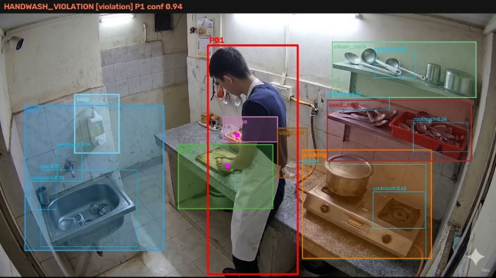
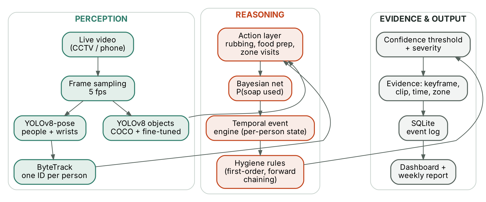
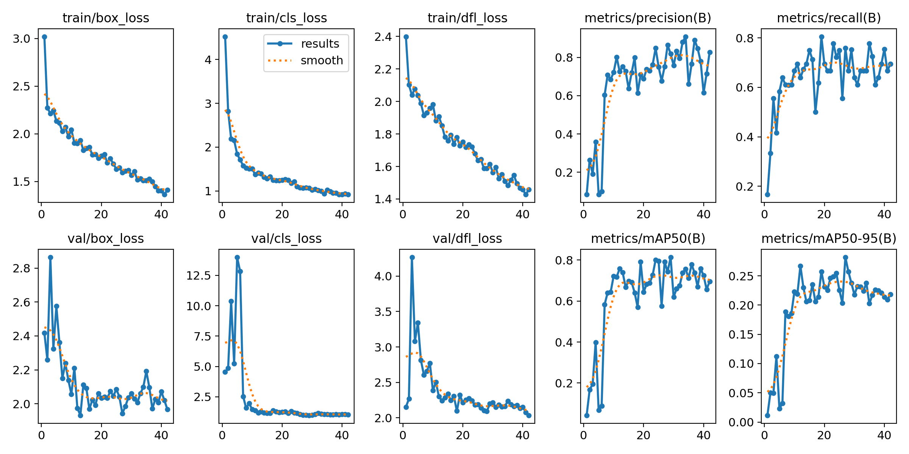

# Can AI Be a Kitchen Hygiene Inspector?

A computer-vision system that watches a kitchen CCTV feed, checks hygiene rules such as **"wash your hands before preparing food"**, and raises explained alerts with evidence: who, when, how confident, and the frame that proves it.


*The cook (P01) starts chopping without washing his hands. The system flags a hand-wash violation with confidence 0.94 and saves this evidence frame. Boxes are the zones marked once for this camera; pink dots are the tracked wrists.*

Built by **Avidha Chandra** for the Introduction to AI course at IIM Sambalpur (BS Data Science & AI), November 2026.

---

## What it does

A hygiene inspector visits now and then; the rules apply every minute. This prototype breaks each rule into small questions a camera can answer (is there a person, where are their hands, how long were they at the sink, what did they do next) and reasons over time:

| Rule | How it is checked |
|---|---|
| Hand-wash before food prep | Wrists at the sink, together and moving for 3+ s, before the wrists reach the cutting board |
| Soap actually used | Bayesian network over three clues: dispenser touched, lather seen, rub long enough |
| Vegetables washed | Basket → sink → board, in that order |
| Dirty utensils | A hand at the used-utensil tray, then the stove, with no sink visit in between |
| Raw → cooked food | Raw-food zone, then cooked-food zone, with no wash in between |
| Pests | Fine-tuned cockroach detector; a pest must persist and **move** to count |
| Head cover, spills, reused oil | Rule hooks ready; need extra trained classes |

When the camera cannot see enough (a cook already in the room when the video starts, or someone blocking the sink), the system says **"uncertain"** instead of blaming anyone.

## How it works



| Layer | What | Algorithm |
|---|---|---|
| Perception | People and wrists | **YOLOv8-pose** (one-stage CNN with a 17-keypoint head) |
| | Identity across frames | **ByteTrack** (Kalman filter + Hungarian matching) |
| | Everyday objects | **YOLOv8** pretrained on COCO |
| | Cockroaches | **YOLOv8n fine-tuned** on 310 labelled photos (transfer learning) |
| Reasoning | Actions over time | Rules on wrist keypoints and zones (washing, food prep) |
| | Soap use | **Bayesian network** with three evidence nodes |
| | Decisions | **First-order rules** with forward chaining, one memory per person (model-based reflex agent) |
| Evidence | Alerts | Severity, confidence, keyframe, short clip, SQLite log, HTML dashboard |

The hand-washing rule in first-order logic, which is why the system never needs to know *who* the cook is:

```
∀p [ InPrepZone(p) ∧ Prepares(p, t₂) ∧ ¬∃t₁ (Washes(p, t₁) ∧ t₁ < t₂) ] ⇒ Violation(p)
```

## Training the detector

The cockroach detector starts from YOLOv8n pretrained on COCO, freezes the first 10 layers and learns the new class from 310 public photos ([nafiz5662/cockroach-detection](https://github.com/nafiz5662/cockroach-detection), converted from Pascal VOC to YOLO format with `tools/voc_to_yolo.py`), split 207 / 36 / 67. Trained on a free Colab T4 GPU at 416 px; early stopping ended it at epoch 42, best at 27. The 416 px run was chosen over a 640 px run on validation mAP (0.79 vs 0.72).

| On 67 unseen test photos | Precision | Recall | F1 | mAP@0.5 | mAP@0.5:0.95 |
|---|---|---|---|---|---|
| Cockroach detector | 0.82 | 0.81 | 0.81 | 0.87 | 0.36 |



## Results on scenario video

Real kitchen footage was not available, so the test scenes are **AI-generated** (Google Veo, image-to-video). One CCTV-style picture of a kitchen was generated first and every clip starts from it, so the camera and zones stay fixed like a real CCTV camera. 12 scenes were made: each main rule done right and wrong, plus two hard cases (two cooks at once, a blocked sink). The answer key (`data/ground_truth.csv`) was written by watching every clip.

Thresholds were tuned on half the scenes (precision-recall sweep, best F1) and tested on the other half.

| | Precision | Recall | F1 |
|---|---|---|---|
| **All 12 scenes** | 0.50 | 0.50 | **0.50** |
| **Untuned test half** | 0.29 | 0.50 | **0.36** |
| Hand-washing | 1.00 | 0.57 | 0.73 |
| Vegetable washing | 1.00 | 0.67 | 0.80 |
| Pests | 0.12 | 1.00 | 0.22 |

**Honest caveats.** Twelve short synthetic scenes is a very small test: one miss moves a rule from 1.00 to 0.00. Hand-washing held up well; every hand-wash alert was correct. The pest detector, trained on real photos, mistakes parts of the AI-drawn stove and drain for cockroaches (a domain gap). The dirty-utensil, cross-contamination and head-cover rules each had one test scene and were missed; head cover needs a cap detector that is not trained yet. These numbers show where the method works and where it breaks, not how it would perform in a real kitchen.

**What changed after the first run** (F1 0.19): people never seen arriving are now "uncertain" instead of blamed; a pest has to move to count; and the answer key was re-checked against the videos. These fixes were made once, then the system was frozen.

## Run it

**Google Colab (easiest)**
1. Put this repo in a Drive folder, e.g. `MyDrive/KitchenHygiene/code`, with your clips in `MyDrive/KitchenHygiene/videos` (`S01.mp4`, `S02.mp4`, …).
2. Open `notebooks/Kitchen_Hygiene_Monitor.ipynb`: tests, zone marking, optional training, processing every clip, dashboard, evaluation and error analysis.
3. Or open `notebooks/Live_Demo.ipynb` for a one-clip live run: alerts table, evidence frame, annotated video, the reasoning behind the decision, and the manager dashboard.

**Locally**
```bash
pip install -r requirements.txt
python tests/test_engine.py          # 20 scripted scenarios for the reasoning layer, no video needed
```
```python
from kitchen_hygiene.config import Config
from kitchen_hygiene.pipeline import process_video
cfg = Config(); cfg.zones = {...}            # zones as fractions of the frame, see the notebook
cfg.custom_models = ["models/best.pt"]
result = process_video("videos/S05.mp4", cfg, "output")
```

Zones are marked once per camera position as polygons in normalised coordinates.

## Repository

```
kitchen_hygiene/   perception, rule engine, Bayesian soap check, pipeline, evaluation, dashboard
tests/             20 scripted scenarios for the reasoning layer
notebooks/         full Colab notebook and the live-demo notebook
tools/             VOC→YOLO conversion, joining clip parts, building the scenario video
data/              answer key for the 12 scenes and an empty template
models/            trained cockroach detector (best.pt)
docs/images/       architecture, training curves, predictions, demo frame
```

## Responsible use

No face recognition: people are anonymous track IDs. Cameras only on food-preparation areas; video processed on site. Every alert carries its evidence and confidence so a person can check it before acting, and the system reports "uncertain" rather than guessing when it cannot see.

## Next steps

Test on real kitchen footage (with permission) · train the remaining classes (rat, fly, cap, gloves, spill) · fine-tune the pest detector on frames from the target camera to close the domain gap · a learned action model (VideoMAE) in place of hand-set rules.

## Credits

Cockroach images: [nafiz5662/cockroach-detection](https://github.com/nafiz5662/cockroach-detection). Models: [Ultralytics YOLOv8](https://github.com/ultralytics/ultralytics). Scenario clips generated with Google Veo.

Licence: MIT.
